<a href="https://deceroai.com">
  <picture>
    <source media="(prefers-color-scheme: dark)" srcset="assets/banner-dark.svg">
    <source media="(prefers-color-scheme: light)" srcset="assets/banner-light.svg">
    
  </picture>
</a>

  
  
  
  

### Hey, I'm Michael 👋

I build the data and AI systems that hold up once real users show up: governed semantic layers that agents can trust, production agents with real identity and guardrails, and the security and observability that keep all of it accountable. I work embedded with teams, from architecture through implementation, inside the tools they already use.

### What I've shipped

<table>
  <tr>
    <th align="left" width="33%">🧱 Data platforms</th>
    <th align="left" width="33%">🤖 AI agents and runtimes</th>
    <th align="left" width="33%">🛡️ Security and operations</th>
  </tr>
  <tr valign="top">
    <td>
      <a href="https://deceroai.com/work/enterprise-semantic-layer"><b>Enterprise semantic layer</b></a> 
      70+ Snowflake databases unified into governed semantic views with 150+ metrics
    </td>
    <td>
      <a href="https://deceroai.com/work/self-service-analytics-agent"><b>Self-service analytics agent</b></a> 
      A Claude Code plugin with 11 domain skills over a governed semantic layer
    </td>
    <td>
      <a href="https://deceroai.com/work/agent-security-architecture"><b>Agent security architecture</b></a> 
      Action firewall, taint propagation, deny-by-default egress, pinned identity
    </td>
  </tr>
  <tr valign="top">
    <td>
      <a href="https://deceroai.com/work/whole-market-scanner"><b>Whole-market scanner</b></a> 
      Real-time screener over 12,400 tickers with 49 preset scans and 56 filters
    </td>
    <td>
      <a href="https://deceroai.com/work/multi-tool-agent-platform"><b>Multi-tool agent platform</b></a> 
      A Slack-native agent with 84 tools across 13 SaaS surfaces, on Kubernetes
    </td>
    <td>
      <a href="https://deceroai.com/work/enterprise-ai-connectors"><b>Enterprise AI connectors</b></a> 
      ChatGPT and Claude Enterprise with key management, OAuth, and audit evidence
    </td>
  </tr>
  <tr valign="top">
    <td>
      <a href="https://deceroai.com/work/data-observability"><b>Data observability</b></a> 
      69 feeds and jobs judged every 5 minutes, one email per incident
    </td>
    <td>
      <a href="https://deceroai.com/work/mcp-research-server"><b>MCP server with OAuth 2.1</b></a> 
      21 research tools, per-member rate limits, sub-minute revocation
    </td>
    <td>
      <a href="https://deceroai.com/work/private-cloud-platform"><b>Private-network cloud platform</b></a> 
      Front Door and WAF over Private Link, deny-by-default egress, all as code
    </td>
  </tr>
</table>

Client work stays confidential, so the write-ups cover the architecture and the controls. Every one has a diagram at <a href="https://deceroai.com/work">deceroai.com/work</a>.

### Field notes

📓 [**Making an AI-assisted platform commercial grade**](https://deceroai.com/work/prototype-to-production): the PR gate, OIDC deploys, private network, append-only data, and detection that let an AI-assisted build carry paying customers.

### Open source

🚧 New projects land at [**@deceroai**](https://github.com/deceroai). Each one ships with tests, CI, docs, and a security pass before its first release.

### Toolbox

  
  
  
  
  
  
  
  
  
  
  
  
  
  
  

de0, LLC d/b/a DeCeroAI Solutions &#183; Waunakee, Wisconsin

